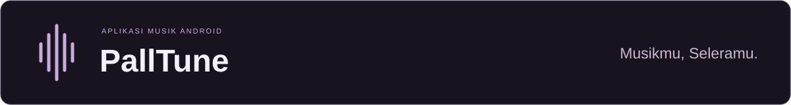

<strong>PallX</strong> &nbsp; / &nbsp; @PallMods

<picture>
<source media="(prefers-color-scheme: light)" srcset="assets/profile-cover-light.svg" />
<source media="(prefers-color-scheme: dark)" srcset="assets/profile-cover.svg" />

</picture>
 
<table>
<tr><td><a href="#tentang"><strong>01</strong> / Tentang</a></td><td><a href="#proyek"><strong>02</strong> / Proyek</a></td><td><a href="#tools"><strong>03</strong> / Tools</a></td></tr>
<tr><td><a href="#repo"><strong>04</strong> / Repository</a></td><td><a href="#kontak"><strong>05</strong> / Kontak</a></td><td><a href="#catatan"><strong>06</strong> / Catatan</a></td></tr>
</table>

<h2>Tentang gw</h2>

Gw PallX, di GitHub pakai <strong>PallMods</strong>. Gw ngerjain aplikasi Android, tampilan web, sama tools yang lagi dibutuhin. Biasanya bolak-balik antara terminal, file proyek, dan log build.

Proyek gw antara lain <strong>PallTune</strong> buat musik dan <strong>CatGhost</strong> buat manajemen WhatsApp. Link proyek dan akun gw ada di bawah.

<table>
<tr><th align="left"></th><th align="left">Catatan singkat</th></tr>
<tr><td>Nama</td><td>PallX</td></tr>
<tr><td>GitHub</td><td><a href="https://github.com/PallMods">@PallMods</a></td></tr>
<tr><td>Yang sering dikerjain</td><td>Android, web, dan tools.</td></tr>
<tr><td>Lingkungan kerja</td><td>Termux, Linux, dan GitHub Actions.</td></tr>
</table>

<h2>Proyek</h2>
<table>
<tr>
<td width="50%" valign="top">

Aplikasi musik Android. Tempat buat cari lagu, nyusun playlist, dan dengerin musik.

<a href="https://palltune.my.id"><strong>Website ↗</strong></a> &nbsp; · &nbsp; <a href="https://github.com/PallMods/PallTune-APK/releases"><strong>Rilis APK ↗</strong></a>

</td>
<td width="50%" valign="top">

Aplikasi manajemen WhatsApp. Kalau mau tanya soal CatGhost, hubungi gw lewat Telegram.

<a href="https://t.me/pallXmodstele"><strong>Tanya CatGhost ↗</strong></a> &nbsp; · &nbsp; <a href="https://whatsapp.com/channel/0029Vb8B7b0DZ4LXD3jpph3N"><strong>Saluran ↗</strong></a>

</td>
</tr>
</table>
<table>
<tr><th align="left">Proyek</th><th align="left">Kegunaan</th><th align="left">Tempat lihat</th></tr>
<tr><td><strong>PallTune</strong></td><td>Musik di Android.</td><td><a href="https://palltune.my.id">Website</a> · <a href="https://github.com/PallMods/PallTune-APK/releases">Releases</a></td></tr>
<tr><td><strong>CatGhost</strong></td><td>Manajemen WhatsApp.</td><td><a href="https://t.me/pallXmodstele">Telegram PallX</a></td></tr>
</table>

<strong>Mau download atau ngikutin kabar proyek?</strong>
 
<table>
<tr><th align="left">Keperluan</th><th align="left">Buka</th></tr>
<tr><td>Download PallTune</td><td><a href="https://github.com/PallMods/PallTune-APK/releases/latest">Halaman rilis terbaru</a></td></tr>
<tr><td>Cari versi PallTune lainnya</td><td><a href="https://github.com/PallMods/PallTune-APK/releases">Semua rilis</a></td></tr>
<tr><td>Kabar dari gw</td><td><a href="https://whatsapp.com/channel/0029Vb8B7b0DZ4LXD3jpph3N">Saluran WhatsApp</a></td></tr>
<tr><td>Tanya langsung</td><td><a href="https://t.me/pallXmodstele">Telegram</a></td></tr>
</table>

<a href="#top">↑ Atas</a>

<h2>Yang ada di meja kerja</h2>

Tools yang sering gw pakai atau pelajari pas ngerjain proyek.

<table>
<tr><th align="left">Bagian</th><th align="left">Biasanya dipakai buat</th></tr>
<tr><td>Android</td><td>Build APK, ngatur tampilan, dan baca log aplikasi.</td></tr>
<tr><td>Termux / Linux</td><td>Jalanin perintah, kelola file, dan nyiapin tools.</td></tr>
<tr><td>Java / C / C++</td><td>Baca dan utak-atik bagian aplikasi yang berkaitan.</td></tr>
<tr><td>Gradle</td><td>Konfigurasi dan task build.</td></tr>
<tr><td>Git / GitHub</td><td>Simpan perubahan dan cek riwayat proyek.</td></tr>
<tr><td>GitHub Actions</td><td>Jalanin workflow build.</td></tr>
</table>

<strong>Catatan yang sering gw buka waktu build macet</strong>
 
<table>
<tr><th align="left">Yang dicek</th><th align="left">Kenapa</th></tr>
<tr><td>Versi Java</td><td>Pastikan cocok dengan kebutuhan proyek.</td></tr>
<tr><td>Error pertama</td><td>Biasanya lebih membantu daripada baris “BUILD FAILED”.</td></tr>
<tr><td>Nama dan path file</td><td>Sering beda huruf besar-kecil atau salah direktori.</td></tr>
<tr><td>Log crash</td><td>Build sukses belum tentu aplikasinya langsung jalan.</td></tr>
</table>

<a href="#top">↑ Atas</a>

<h2>Cari repository</h2>

Mau langsung lihat source atau proyek lain? Pilih dari sini.

<table>
<tr><th align="left">Tampilan</th><th align="left">Tautan</th></tr>
<tr><td>Semua repository</td><td><a href="https://github.com/PallMods?tab=repositories">Buka daftar →</a></td></tr>
<tr><td>Yang baru diperbarui</td><td><a href="https://github.com/PallMods?tab=repositories&amp;sort=updated">Urutkan terbaru →</a></td></tr>
<tr><td>Filter Java</td><td><a href="https://github.com/PallMods?tab=repositories&amp;language=java">Lihat Java →</a></td></tr>
<tr><td>Filter C++</td><td><a href="https://github.com/PallMods?tab=repositories&amp;language=c%2B%2B">Lihat C++ →</a></td></tr>
<tr><td>Repo yang gw tandai</td><td><a href="https://github.com/PallMods?tab=stars">Starred →</a></td></tr>
</table>

<h2>Cari gw di sini</h2>
<table>
<tr><th align="left">Platform</th><th align="left">Akun / saluran</th><th align="left">Buat apa</th></tr>
<tr><td>Telegram</td><td><a href="https://t.me/pallXmodstele">@pallXmodstele</a></td><td>Tanya proyek atau hubungi gw.</td></tr>
<tr><td>WhatsApp</td><td><a href="https://whatsapp.com/channel/0029Vb8B7b0DZ4LXD3jpph3N">Saluran PallX</a></td><td>Kabar dan info yang gw bagikan.</td></tr>
<tr><td>TikTok</td><td><a href="https://www.tiktok.com/@palxmdm">@palxmdm</a></td><td>Konten gw.</td></tr>
<tr><td>GitHub</td><td><a href="https://github.com/PallMods">@PallMods</a></td><td>Repo, source, dan rilis.</td></tr>
</table>

Kalau ketemu akun lain yang mengatasnamakan PallX, cocokin dulu sama tautan di tabel ini. Bisa tanya lewat Telegram.

<a href="#top">↑ Atas</a>

<h2>Catatan kecil</h2>

<strong>Beberapa pertanyaan yang sering muncul</strong>
 
<table>
<tr><th align="left">Pertanyaan</th><th align="left">Jawaban</th></tr>
<tr><td>PallX sama PallMods beda?</td><td>PallX nama yang gw pakai. PallMods username GitHub gw.</td></tr>
<tr><td>PallTune download di mana?</td><td><a href="https://github.com/PallMods/PallTune-APK/releases">Di GitHub Releases</a>. Lewat halaman rilis supaya nama file versi baru tetap ketemu.</td></tr>
<tr><td>Ada source semua aplikasi?</td><td>Yang bisa dibuka ada di daftar repo publik. Untuk yang lain, tanya dulu lewat Telegram.</td></tr>
<tr><td>Bisa kontak langsung?</td><td>Bisa, pakai Telegram yang ada di tabel kontak.</td></tr>
</table>

 

<strong>Logo dan tampilan profil</strong>
 
<table>
<tr><th align="left">File</th><th align="left">Buka</th></tr>
<tr><td>Logo PallMods</td><td><a href="assets/logo.png">Lihat logo</a></td></tr>
<tr><td>Banner gelap</td><td><a href="assets/profile-cover.svg">Lihat banner</a></td></tr>
<tr><td>Banner terang</td><td><a href="assets/profile-cover-light.svg">Lihat banner</a></td></tr>
</table>

<strong>PallX</strong> &nbsp; · &nbsp; <a href="https://github.com/PallMods">GitHub</a> &nbsp; · &nbsp; <a href="https://t.me/pallXmodstele">Telegram</a> &nbsp; · &nbsp; <a href="https://whatsapp.com/channel/0029Vb8B7b0DZ4LXD3jpph3N">Saluran</a>

