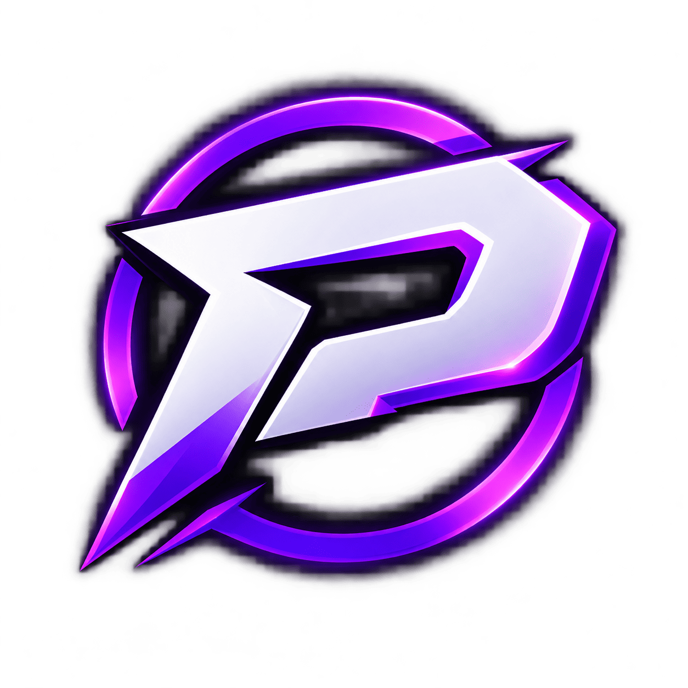
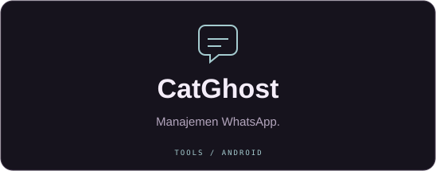
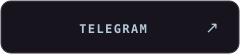
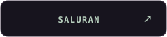
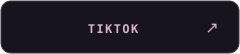
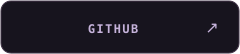
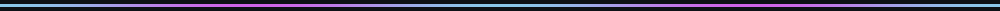

<picture>
<source media="(prefers-color-scheme: light)" srcset="assets/profile-cover-light.svg" />
<source media="(prefers-color-scheme: dark)" srcset="assets/profile-cover.svg" />

</picture>
<table align="center" width="1200"><tr>
<td align="center" width="300"> <a href="#proyek"><strong>PROYEK</strong></a></td>
<td align="center" width="300"> <a href="#tentang"><strong>TENTANG</strong></a></td>
<td align="center" width="300"> <a href="#tools"><strong>TOOLS</strong></a></td>
<td align="center" width="300"> <a href="#kontak"><strong>KONTAK</strong></a></td>
</tr></table>

<h2 align="center">Proyek yang gw kerjain</h2>
<table align="center" width="1200">
<tr><td align="center" width="1200">

Aplikasi musik Android buat cari lagu, bikin playlist, dan dengerin musik.

<a href="https://palltune.my.id"><strong>WEBSITE ↗</strong></a> &nbsp; · &nbsp; <a href="https://github.com/PallMods/PallTune-APK/releases"><strong>DOWNLOAD / RILIS ↗</strong></a>

</td></tr>
<tr><td align="center" width="1200">

Aplikasi manajemen WhatsApp. Tanya soal CatGhost bisa langsung lewat Telegram.

<a href="https://t.me/pallXmodstele"><strong>TELEGRAM ↗</strong></a> &nbsp; · &nbsp; <a href="https://whatsapp.com/channel/0029Vb8B7b0DZ4LXD3jpph3N"><strong>SALURAN ↗</strong></a>

</td></tr>
</table>

<strong>Download &amp; kabar proyek</strong>
 
<table align="center" width="1200">
<tr><th align="left" width="600"> Mau cari</th><th align="left" width="600"> Langsung ke</th></tr>
<tr><td align="left" width="600">PallTune versi terbaru</td><td align="left" width="600"><a href="https://github.com/PallMods/PallTune-APK/releases/latest">Halaman rilis →</a></td></tr>
<tr><td align="left" width="600">PallTune versi sebelumnya</td><td align="left" width="600"><a href="https://github.com/PallMods/PallTune-APK/releases">Daftar rilis →</a></td></tr>
<tr><td align="left" width="600">Info proyek lainnya</td><td align="left" width="600"><a href="https://whatsapp.com/channel/0029Vb8B7b0DZ4LXD3jpph3N">Saluran WhatsApp →</a></td></tr>
<tr><td align="left" width="600">Tanya soal aplikasi</td><td align="left" width="600"><a href="https://t.me/pallXmodstele">Telegram PallX →</a></td></tr>
</table>

 

<h2 align="center">Gw PallX, di sini PallMods</h2>

Gw ngerjain aplikasi Android, tampilan web, dan tools. Sebagian prosesnya lewat HP, lanjut di terminal atau GitHub Actions kalau perlu. Biasanya yang paling sering kebuka ya file proyek sama log error.

<table align="center" width="1200">
<tr><th align="left" width="600"> Tentang gw</th><th align="left" width="600"> </th></tr>
<tr><td align="left" width="600">Nama</td><td align="left" width="600"><strong>PallX</strong></td></tr>
<tr><td align="left" width="600">Username GitHub</td><td align="left" width="600"><a href="https://github.com/PallMods">@PallMods</a></td></tr>
<tr><td align="left" width="600">Proyek</td><td align="left" width="600">PallTune · CatGhost</td></tr>
<tr><td align="left" width="600">Yang sering diulik</td><td align="left" width="600">Android · web · terminal</td></tr>
</table>
<table align="center" width="1200">
<tr><th align="left" width="600"> Di proyek</th><th align="left" width="600"> Yang gw urus</th></tr>
<tr><td align="left" width="600">Aplikasi</td><td align="left" width="600">Tampilan, build APK, dan perbaikan yang dibutuhkan.</td></tr>
<tr><td align="left" width="600">Website</td><td align="left" width="600">Halaman proyek, tautan unduhan, dan informasi aplikasi.</td></tr>
<tr><td align="left" width="600">Tools</td><td align="left" width="600">Skrip dan langkah kerja supaya lebih praktis.</td></tr>
</table>

<h2 align="center">Tools &amp; lingkungan kerja</h2>

Yang sering gw pakai atau pelajari pas ngerjain proyek.

<table align="center" width="1200">
<tr><th align="left" width="600"> Bagian</th><th align="left" width="600"> Dipakai buat</th></tr>
<tr><td align="left" width="600">Android</td><td align="left" width="600">Build APK, tampilan aplikasi, dan log crash.</td></tr>
<tr><td align="left" width="600">Termux / Linux</td><td align="left" width="600">Perintah terminal, file, dan tools.</td></tr>
<tr><td align="left" width="600">Java / C / C++</td><td align="left" width="600">Bagian aplikasi dan kode native.</td></tr>
<tr><td align="left" width="600">Gradle</td><td align="left" width="600">Konfigurasi dan task build.</td></tr>
<tr><td align="left" width="600">Git / GitHub Actions</td><td align="left" width="600">Riwayat perubahan dan workflow build.</td></tr>
</table>

<strong>Kalau build lagi bermasalah</strong>
 
<table align="center" width="1200">
<tr><th align="left" width="600"> Cek dulu</th><th align="left" width="600"> Catatan</th></tr>
<tr><td align="left" width="600">Java</td><td align="left" width="600">Versi yang dipakai harus cocok sama kebutuhan proyek.</td></tr>
<tr><td align="left" width="600">Log pertama</td><td align="left" width="600">Cari penyebab awalnya, jangan cuma baca “BUILD FAILED”.</td></tr>
<tr><td align="left" width="600">File / direktori</td><td align="left" width="600">Periksa nama, huruf besar-kecil, dan path.</td></tr>
<tr><td align="left" width="600">Aplikasi force close</td><td align="left" width="600">Ambil log saat crash, meskipun build sudah selesai.</td></tr>
</table>

<a href="#top">↑ Ke atas</a>

<h2 align="center">Repository</h2>

Source dan proyek lain yang tersedia ada di tab repository.

<table align="center" width="1200">
<tr><td align="center" width="600"> <a href="https://github.com/PallMods?tab=repositories">Semua repository ↗</a></td><td align="center" width="600"> <a href="https://github.com/PallMods?tab=repositories&amp;sort=updated">Baru diperbarui ↗</a></td></tr>
<tr><td align="center" width="600"><a href="https://github.com/PallMods?tab=repositories&amp;language=java">Filter Java ↗</a></td><td align="center" width="600"><a href="https://github.com/PallMods?tab=repositories&amp;language=c%2B%2B">Filter C++ ↗</a></td></tr>
<tr><td align="center" width="600"><a href="https://github.com/PallMods?tab=stars">Starred ↗</a></td><td align="center" width="600"><a href="https://github.com/PallMods/PallMods/commits/main/">Riwayat profil ↗</a></td></tr>
</table>

<h2 align="center">Kontak &amp; saluran</h2>

Tanya proyek lewat Telegram. Untuk kabar yang gw bagikan, ada salurannya.

    

<table align="center" width="1200">
<tr><th align="left" width="400"> Platform</th><th align="left" width="400"> Akun / saluran</th><th align="left" width="400"> Keperluan</th></tr>
<tr><td align="left" width="400">Telegram</td><td align="left" width="400"><a href="https://t.me/pallXmodstele">@pallXmodstele</a></td><td align="left" width="400">Hubungi gw langsung.</td></tr>
<tr><td align="left" width="400">WhatsApp</td><td align="left" width="400"><a href="https://whatsapp.com/channel/0029Vb8B7b0DZ4LXD3jpph3N">Saluran PallX</a></td><td align="left" width="400">Info yang gw bagikan.</td></tr>
<tr><td align="left" width="400">TikTok</td><td align="left" width="400"><a href="https://www.tiktok.com/@palxmdm">@palxmdm</a></td><td align="left" width="400">Konten gw.</td></tr>
<tr><td align="left" width="400">GitHub</td><td align="left" width="400"><a href="https://github.com/PallMods">@PallMods</a></td><td align="left" width="400">Source dan rilis proyek.</td></tr>
</table>

Cocokin akun yang mengatasnamakan PallX dengan tautan di atas. Kalau ragu, tanya gw di Telegram.

<strong>Tanya singkat</strong>
 
<table align="center" width="1200">
<tr><th align="left" width="600"> Pertanyaan</th><th align="left" width="600"> Jawaban</th></tr>
<tr><td align="left" width="600">PallX dan PallMods beda?</td><td align="left" width="600">PallX nama yang gw pakai. PallMods username GitHub gw.</td></tr>
<tr><td align="left" width="600">Download PallTune di mana?</td><td align="left" width="600"><a href="https://github.com/PallMods/PallTune-APK/releases">GitHub Releases</a>. Pilih dari halaman rilis supaya nama file tiap versi tetap ketemu.</td></tr>
<tr><td align="left" width="600">Semua source tersedia?</td><td align="left" width="600">Yang bisa dibuka ada di repo publik. Untuk lainnya, tanya gw dulu.</td></tr>
</table>

 

<strong>Logo &amp; banner profil</strong>
 
<table align="center" width="1200">
<tr><th align="left" width="600"> Aset</th><th align="left" width="600"> Tautan</th></tr>
<tr><td align="left" width="600">Logo asli</td><td align="left" width="600"><a href="assets/logo.png">Lihat logo →</a></td></tr>
<tr><td align="left" width="600">Banner gelap</td><td align="left" width="600"><a href="assets/profile-cover.svg">Lihat banner →</a></td></tr>
<tr><td align="left" width="600">Banner terang</td><td align="left" width="600"><a href="assets/profile-cover-light.svg">Lihat banner →</a></td></tr>
</table>

<strong>PallX / PallMods</strong> <a href="https://t.me/pallXmodstele">Telegram</a> &nbsp; · &nbsp; <a href="https://whatsapp.com/channel/0029Vb8B7b0DZ4LXD3jpph3N">Saluran</a> &nbsp; · &nbsp; <a href="#top">Kembali ke atas</a>

