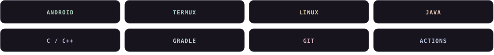

<strong>PallX</strong> &nbsp; / &nbsp; @PallMods

<picture>
<source media="(prefers-color-scheme: light)" srcset="assets/profile-cover-light.svg" />
<source media="(prefers-color-scheme: dark)" srcset="assets/profile-cover.svg" />

</picture>
 
<table align="center">
<tr><td align="center"><a href="#tentang"><strong>01</strong> / Tentang</a></td><td align="center"><a href="#proyek"><strong>02</strong> / Proyek</a></td><td align="center"><a href="#tools"><strong>03</strong> / Tools</a></td></tr>
<tr><td align="center"><a href="#repo"><strong>04</strong> / Repository</a></td><td align="center"><a href="#kontak"><strong>05</strong> / Kontak</a></td><td align="center"><a href="#catatan"><strong>06</strong> / Catatan</a></td></tr>
</table>

<h2 align="center">Tentang gw</h2>

Gw PallX, di GitHub pakai <strong>PallMods</strong>. Gw ngerjain aplikasi Android, tampilan web, sama tools yang lagi dibutuhin. Biasanya bolak-balik antara terminal, file proyek, dan log build.

Proyek gw antara lain <strong>PallTune</strong> buat musik dan <strong>CatGhost</strong> buat manajemen WhatsApp. Link proyek dan akun gw ada di bawah.

<table align="center">
<tr><th align="center"></th><th align="center">Catatan singkat</th></tr>
<tr><td align="center">Nama</td><td align="center">PallX</td></tr>
<tr><td align="center">GitHub</td><td align="center"><a href="https://github.com/PallMods">@PallMods</a></td></tr>
<tr><td align="center">Yang sering dikerjain</td><td align="center">Android, web, dan tools.</td></tr>
<tr><td align="center">Lingkungan kerja</td><td align="center">Termux, Linux, dan GitHub Actions.</td></tr>
</table>

<h2 align="center">Proyek</h2>
<table align="center">
<tr>
<td align="center" width="50%" valign="top">

Aplikasi musik Android. Tempat buat cari lagu, nyusun playlist, dan dengerin musik.

<a href="https://palltune.my.id"><strong>Website ↗</strong></a> &nbsp; · &nbsp; <a href="https://github.com/PallMods/PallTune-APK/releases"><strong>Rilis APK ↗</strong></a>

</td>
<td align="center" width="50%" valign="top">

Aplikasi manajemen WhatsApp. Kalau mau tanya soal CatGhost, hubungi gw lewat Telegram.

<a href="https://t.me/pallXmodstele"><strong>Tanya CatGhost ↗</strong></a> &nbsp; · &nbsp; <a href="https://whatsapp.com/channel/0029Vb8B7b0DZ4LXD3jpph3N"><strong>Saluran ↗</strong></a>

</td>
</tr>
</table>
<table align="center">
<tr><th align="center">Proyek</th><th align="center">Kegunaan</th><th align="center">Tempat lihat</th></tr>
<tr><td align="center"><strong>PallTune</strong></td><td align="center">Musik di Android.</td><td align="center"><a href="https://palltune.my.id">Website</a> · <a href="https://github.com/PallMods/PallTune-APK/releases">Releases</a></td></tr>
<tr><td align="center"><strong>CatGhost</strong></td><td align="center">Manajemen WhatsApp.</td><td align="center"><a href="https://t.me/pallXmodstele">Telegram PallX</a></td></tr>
</table>

<strong>Mau download atau ngikutin kabar proyek?</strong>
 
<table align="center">
<tr><th align="center">Keperluan</th><th align="center">Buka</th></tr>
<tr><td align="center">Download PallTune</td><td align="center"><a href="https://github.com/PallMods/PallTune-APK/releases/latest">Halaman rilis terbaru</a></td></tr>
<tr><td align="center">Cari versi PallTune lainnya</td><td align="center"><a href="https://github.com/PallMods/PallTune-APK/releases">Semua rilis</a></td></tr>
<tr><td align="center">Kabar dari gw</td><td align="center"><a href="https://whatsapp.com/channel/0029Vb8B7b0DZ4LXD3jpph3N">Saluran WhatsApp</a></td></tr>
<tr><td align="center">Tanya langsung</td><td align="center"><a href="https://t.me/pallXmodstele">Telegram</a></td></tr>
</table>

<a href="#top">↑ Atas</a>

<h2 align="center">Yang ada di meja kerja</h2>

Tools yang sering gw pakai atau pelajari pas ngerjain proyek.

<table align="center">
<tr><th align="center">Bagian</th><th align="center">Biasanya dipakai buat</th></tr>
<tr><td align="center">Android</td><td align="center">Build APK, ngatur tampilan, dan baca log aplikasi.</td></tr>
<tr><td align="center">Termux / Linux</td><td align="center">Jalanin perintah, kelola file, dan nyiapin tools.</td></tr>
<tr><td align="center">Java / C / C++</td><td align="center">Baca dan utak-atik bagian aplikasi yang berkaitan.</td></tr>
<tr><td align="center">Gradle</td><td align="center">Konfigurasi dan task build.</td></tr>
<tr><td align="center">Git / GitHub</td><td align="center">Simpan perubahan dan cek riwayat proyek.</td></tr>
<tr><td align="center">GitHub Actions</td><td align="center">Jalanin workflow build.</td></tr>
</table>

<strong>Catatan yang sering gw buka waktu build macet</strong>
 
<table align="center">
<tr><th align="center">Yang dicek</th><th align="center">Kenapa</th></tr>
<tr><td align="center">Versi Java</td><td align="center">Pastikan cocok dengan kebutuhan proyek.</td></tr>
<tr><td align="center">Error pertama</td><td align="center">Biasanya lebih membantu daripada baris “BUILD FAILED”.</td></tr>
<tr><td align="center">Nama dan path file</td><td align="center">Sering beda huruf besar-kecil atau salah direktori.</td></tr>
<tr><td align="center">Log crash</td><td align="center">Build sukses belum tentu aplikasinya langsung jalan.</td></tr>
</table>

<a href="#top">↑ Atas</a>

<h2 align="center">Cari repository</h2>

Mau langsung lihat source atau proyek lain? Pilih dari sini.

<table align="center">
<tr><th align="center">Tampilan</th><th align="center">Tautan</th></tr>
<tr><td align="center">Semua repository</td><td align="center"><a href="https://github.com/PallMods?tab=repositories">Buka daftar →</a></td></tr>
<tr><td align="center">Yang baru diperbarui</td><td align="center"><a href="https://github.com/PallMods?tab=repositories&amp;sort=updated">Urutkan terbaru →</a></td></tr>
<tr><td align="center">Filter Java</td><td align="center"><a href="https://github.com/PallMods?tab=repositories&amp;language=java">Lihat Java →</a></td></tr>
<tr><td align="center">Filter C++</td><td align="center"><a href="https://github.com/PallMods?tab=repositories&amp;language=c%2B%2B">Lihat C++ →</a></td></tr>
<tr><td align="center">Repo yang gw tandai</td><td align="center"><a href="https://github.com/PallMods?tab=stars">Starred →</a></td></tr>
</table>

<h2 align="center">Cari gw di sini</h2>
<table align="center">
<tr><th align="center">Platform</th><th align="center">Akun / saluran</th><th align="center">Buat apa</th></tr>
<tr><td align="center">Telegram</td><td align="center"><a href="https://t.me/pallXmodstele">@pallXmodstele</a></td><td align="center">Tanya proyek atau hubungi gw.</td></tr>
<tr><td align="center">WhatsApp</td><td align="center"><a href="https://whatsapp.com/channel/0029Vb8B7b0DZ4LXD3jpph3N">Saluran PallX</a></td><td align="center">Kabar dan info yang gw bagikan.</td></tr>
<tr><td align="center">TikTok</td><td align="center"><a href="https://www.tiktok.com/@palxmdm">@palxmdm</a></td><td align="center">Konten gw.</td></tr>
<tr><td align="center">GitHub</td><td align="center"><a href="https://github.com/PallMods">@PallMods</a></td><td align="center">Repo, source, dan rilis.</td></tr>
</table>

Kalau ketemu akun lain yang mengatasnamakan PallX, cocokin dulu sama tautan di tabel ini. Bisa tanya lewat Telegram.

<a href="#top">↑ Atas</a>

<h2 align="center">Catatan kecil</h2>

<strong>Beberapa pertanyaan yang sering muncul</strong>
 
<table align="center">
<tr><th align="center">Pertanyaan</th><th align="center">Jawaban</th></tr>
<tr><td align="center">PallX sama PallMods beda?</td><td align="center">PallX nama yang gw pakai. PallMods username GitHub gw.</td></tr>
<tr><td align="center">PallTune download di mana?</td><td align="center"><a href="https://github.com/PallMods/PallTune-APK/releases">Di GitHub Releases</a>. Lewat halaman rilis supaya nama file versi baru tetap ketemu.</td></tr>
<tr><td align="center">Ada source semua aplikasi?</td><td align="center">Yang bisa dibuka ada di daftar repo publik. Untuk yang lain, tanya dulu lewat Telegram.</td></tr>
<tr><td align="center">Bisa kontak langsung?</td><td align="center">Bisa, pakai Telegram yang ada di tabel kontak.</td></tr>
</table>

 

<strong>Logo dan tampilan profil</strong>
 
<table align="center">
<tr><th align="center">File</th><th align="center">Buka</th></tr>
<tr><td align="center">Logo PallMods</td><td align="center"><a href="assets/logo.png">Lihat logo</a></td></tr>
<tr><td align="center">Banner gelap</td><td align="center"><a href="assets/profile-cover.svg">Lihat banner</a></td></tr>
<tr><td align="center">Banner terang</td><td align="center"><a href="assets/profile-cover-light.svg">Lihat banner</a></td></tr>
</table>

<strong>PallX</strong> &nbsp; · &nbsp; <a href="https://github.com/PallMods">GitHub</a> &nbsp; · &nbsp; <a href="https://t.me/pallXmodstele">Telegram</a> &nbsp; · &nbsp; <a href="https://whatsapp.com/channel/0029Vb8B7b0DZ4LXD3jpph3N">Saluran</a>

