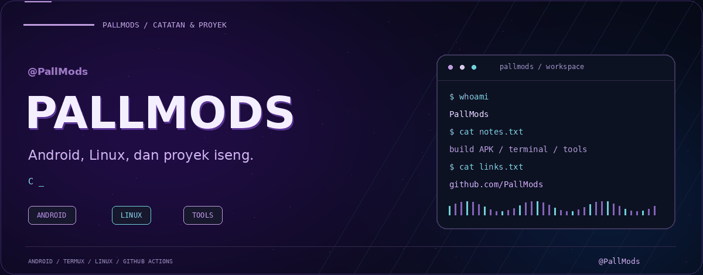
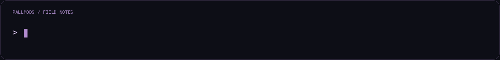
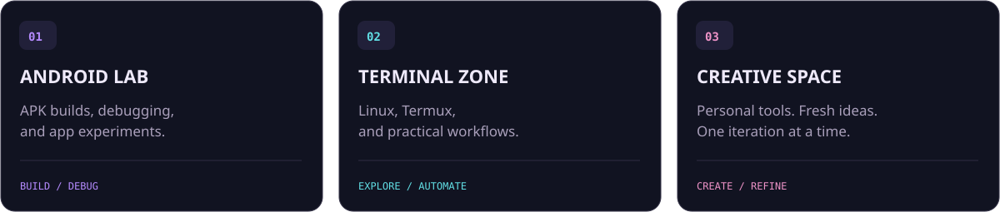
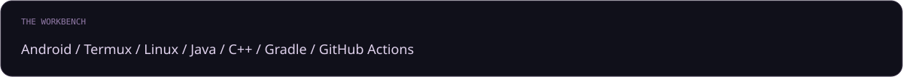
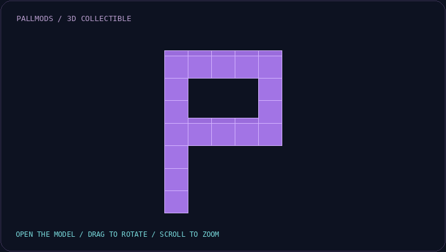
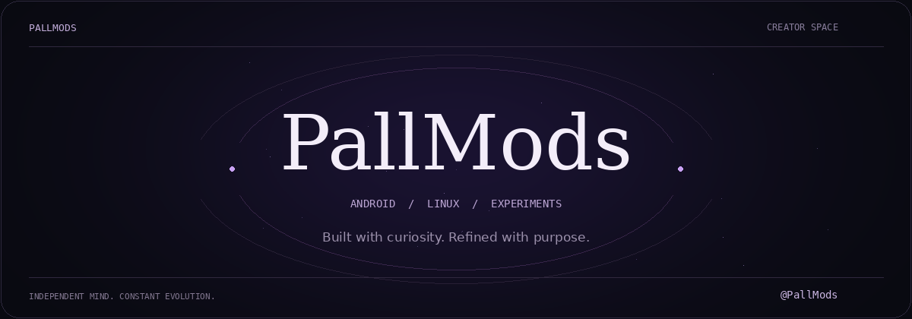
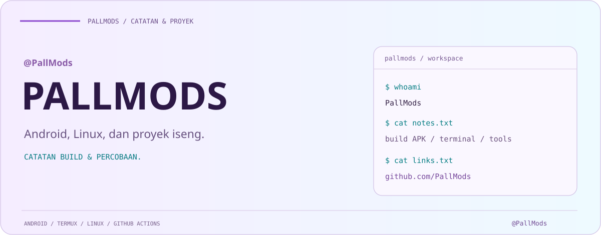
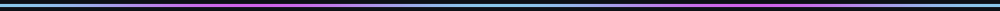
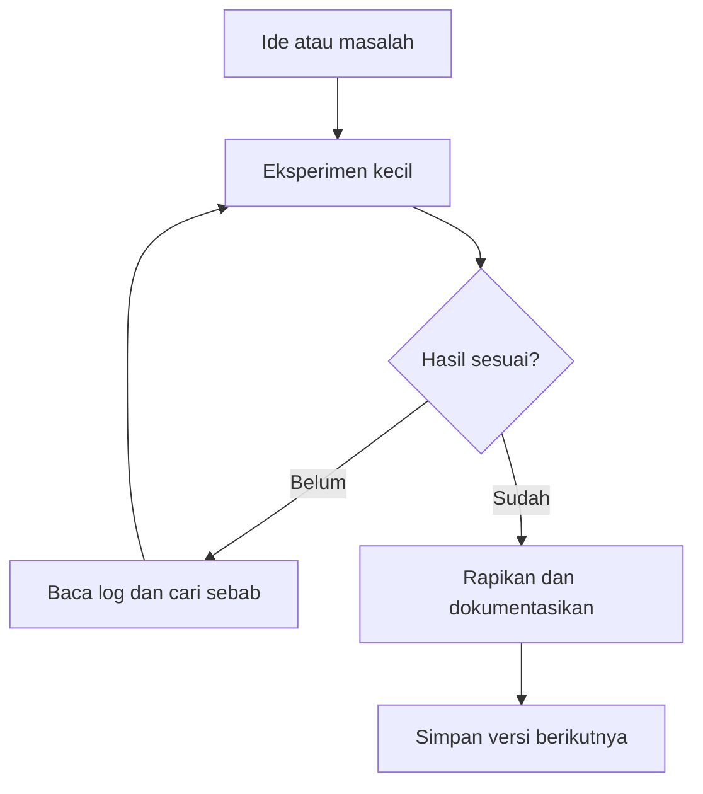

<a name="top"></a>
<p align="center"><strong>QUICK NAVIGATION</strong></p>
<p align="center"><a href="#about"></a> <a href="#control-room"></a> <a href="#toolbox"></a> <a href="#paths"></a> <a href="#faq"></a> <a href="#explore"></a> </p>
<p align="center"><a href="#three-d"></a> <a href="#data-room"></a> <a href="#gallery"></a> <a href="#code-vault"></a> <a href="#learning-hub"></a> <a href="#workspace-map"></a> </p>
<p align="center"></p>
<h1 align="center">PallMods</h1>
<p align="center"><strong>ANDROID ENTHUSIAST · TERMINAL EXPLORER · CREATIVE BUILDER</strong></p>
<p align="center">Ide liar. Rasa penasaran. Selalu ada yang bisa diulik.</p>
<p align="center">
<a href="https://github.com/PallMods?tab=repositories"></a>
<a href="https://github.com/PallMods"></a>
<a href="https://github.com/PallMods?tab=stars"></a>
</p>
<picture>
<source media="(prefers-color-scheme: light)" srcset="assets/hero-light.svg" />
<source media="(prefers-color-scheme: dark)" srcset="assets/hero.gif" />

</picture>


<a name="about"></a>
<h2>⚡ Behind the username</h2>
<table>
<tr>
<td width="50%" valign="top">
<h3>Hey, gw PallMods 👋</h3>
<p>Gw suka ngulik <strong>Android, Linux, dan tools</strong> — dari build APK, debugging, sampai nyari cara biar workflow lebih praktis.</p>
<p>Belajar lewat eksperimen. Ketemu error, cari akarnya. Udah jalan, bikin lebih baik lagi.</p>
<p>📱 <strong>Android</strong> &nbsp; 🐧 <strong>Linux</strong> &nbsp; 🎮 <strong>Gaming</strong></p>
</td>
<td width="50%" valign="middle">

</td>
</tr>
</table>

<a name="control-room"></a>
<h2>🎛️ Interactive control room</h2>
<p><strong>Klik panel buat buka isinya.</strong> Pilih jalur yang bikin lu penasaran.</p>
<details open>
<summary><strong>🗂️ REPOSITORY FINDER — pilih tampilan</strong></summary>
<br />
<table>
<tr><td><a href="https://github.com/PallMods?tab=repositories&amp;sort=updated"><strong>🕒 Terakhir diperbarui</strong></a></td><td><a href="https://github.com/PallMods?tab=repositories&amp;sort=stargazers"><strong>⭐ Urutkan berdasarkan stars</strong></a></td></tr>
<tr><td><a href="https://github.com/PallMods?tab=repositories&amp;language=java"><strong>☕ Bahasa Java</strong></a></td><td><a href="https://github.com/PallMods?tab=repositories&amp;language=c%2B%2B"><strong>⚙️ Bahasa C++</strong></a></td></tr>
<tr><td><a href="https://github.com/PallMods?tab=repositories&amp;q=android"><strong>📱 Nama repo: android</strong></a></td><td><a href="https://github.com/PallMods?tab=repositories&amp;q=tool"><strong>🛠️ Nama repo: tool</strong></a></td></tr>
</table>
<p><sub>Tombol membuka hasil filter GitHub. Hasilnya mengikuti repo publik yang tersedia.</sub></p>
</details>
<br />
<details>
<summary><strong>📡 PROFILE EXPLORER — lihat sisi lain workspace</strong></summary>
<br />
<p><a href="https://github.com/PallMods?tab=overview">📍 Overview &amp; kontribusi</a> · <a href="https://github.com/PallMods?tab=repositories">📦 Semua repository</a> · <a href="https://github.com/PallMods?tab=stars">⭐ Starred projects</a></p>
<p><a href="https://github.com/PallMods?tab=followers">👥 Followers</a> · <a href="https://github.com/PallMods?tab=following">🛰️ Following</a> · <a href="https://github.com/PallMods/PallMods/commits/main/">📝 Riwayat profil ini</a></p>
</details>
<br />
<details>
<summary><strong>🧰 TOOL INSPECTOR — klik tool buat kenalan</strong></summary>
<br />
<details><summary><strong>📱 Android</strong></summary><p>Tempat ngulik aplikasi, proses build, dan debugging. APK jadi hasil akhirnya, proses belajarnya ada di sepanjang jalan.</p><p><a href="https://developer.android.com/docs">Buka dokumentasi Android →</a></p></details>
<details><summary><strong>🐧 Linux &amp; Termux</strong></summary><p>Terminal jadi ruang kerja: kelola file, jalankan tools, dan cobain workflow dari HP atau Linux.</p><p><a href="https://github.com/termux/termux-app">Jelajahi Termux →</a></p></details>
<details><summary><strong>⚙️ Gradle</strong></summary><p>Bagian dari perjalanan build Android: pahami task, konfigurasi, dan log saat proses build berhenti.</p><p><a href="https://docs.gradle.org/current/userguide/userguide.html">Buka panduan Gradle →</a></p></details>
<details><summary><strong>🚀 GitHub Actions</strong></summary><p>Eksplorasi otomatisasi supaya langkah berulang bisa dijalankan lewat workflow.</p><p><a href="https://docs.github.com/en/actions">Buka panduan Actions →</a></p></details>
</details>
<br />
<details>
<summary><strong>⌨️ QUICK COMMANDS — buka &amp; salin</strong></summary>

<p>Ambil salinan repository profil ini:</p>

```bash
git clone https://github.com/PallMods/PallMods.git
cd PallMods
```

<p>Periksa perubahan sebelum disimpan:</p>

```bash
git status
git diff
```

<p><sub>Gunakan tombol Copy pada blok kode GitHub. Perintah ini tidak menjalankan build atau mengubah akun.</sub></p>

</details>
<p align="right"><a href="#top">↑ Kembali ke atas</a></p>

<a name="focus"></a>
<h2>🚀 What happens here</h2>
<p></p>

<a name="toolbox"></a>
<h2>🛠️ My workbench</h2>
<p>Tools yang gw pakai dan pelajari sepanjang proses.</p>
<p></p>

<a name="direction"></a>
<h2>🧭 Current direction</h2>
<table>
<tr><th align="left">FOCUS</th><th align="left">THE JOURNEY</th></tr>
<tr><td>📦 <strong>Build better</strong></td><td>Ngulik proses build APK dan otomatisasi lewat GitHub Actions.</td></tr>
<tr><td>🔍 <strong>Understand deeper</strong></td><td>Belajar baca error dan pahami penyebabnya.</td></tr>
<tr><td>🎨 <strong>Make it personal</strong></td><td>Kasih identitas dan karakter ke setiap eksperimen.</td></tr>
<tr><td>🌱 <strong>Keep evolving</strong></td><td>Belajar dari hasil, perbaiki, lalu coba lagi.</td></tr>
</table>

<a name="paths"></a>
<h2>🗺️ Choose your path</h2>
<p>Mulai dari mana? Buka salah satu jalur di bawah.</p>
<details>
<summary><strong>📱 PATH 01 · Android explorer</strong></summary>
<br />
<table>
<tr><th>LANGKAH</th><th>YANG DIKULIK</th></tr>
<tr><td>01 · Kenali proyek</td><td>Pahami struktur file dan konfigurasi build.</td></tr>
<tr><td>02 · Baca log</td><td>Cari error pertama yang menjelaskan masalah.</td></tr>
<tr><td>03 · Perbaiki bertahap</td><td>Ubah satu penyebab, lalu periksa hasilnya.</td></tr>
</table>
<p><a href="https://github.com/PallMods?tab=repositories&amp;q=android"><strong>Cari repo Android →</strong></a> · <a href="#toolbox">Lihat workbench</a></p>
</details>
<br />
<details>
<summary><strong>🐧 PATH 02 · Terminal wanderer</strong></summary>
<br />
<p><strong>Mulai kecil:</strong> pahami direktori, file, dan perintah yang dijalankan. Lanjut ke workflow yang bisa diulang dan gampang diperiksa.</p>
<blockquote>Terminal makin berguna ketika lu tahu apa yang sedang dikerjakan setiap perintah.</blockquote>
<p><a href="https://github.com/PallMods?tab=repositories&amp;q=tool"><strong>Cari repo tools →</strong></a> · <a href="#control-room">Buka quick commands</a></p>
</details>
<br />
<details>
<summary><strong>🎨 PATH 03 · Creative builder</strong></summary>
<br />
<p><strong>Ide → versi pertama → lihat hasil → rapikan.</strong> Pilih satu hal yang pengin dibuat lebih enak dipakai, terus coba mulai dari situ.</p>
<p><a href="https://github.com/PallMods?tab=stars"><strong>Cari inspirasi di starred projects →</strong></a> · <a href="#explore">Jelajahi workspace</a></p>
</details>
<br />
<details>
<summary><strong>🕵️ PATH 04 · Curious visitor</strong></summary>
<br />
<p>Belum tahu mau lihat apa? Mulai dari repo yang baru diperbarui, buka README-nya, lalu intip file dan riwayat perubahannya.</p>
<p><a href="https://github.com/PallMods?tab=repositories&amp;sort=updated"><strong>Lihat aktivitas proyek →</strong></a> · <a href="#faq">Baca FAQ</a></p>
</details>
<p align="right"><a href="#top">↑ Kembali ke atas</a></p>

<a name="three-d"></a>
<h2>💎 3D collectible lab</h2>
<p><strong>Logo PallMods asli dalam relief 3D, bisa diputar dan di-zoom.</strong> Klik preview untuk masuk ke viewer 3D GitHub.</p>
<p align="center"><a href="assets/pallmods-logo.stl"></a></p>
<p align="center"><a href="assets/pallmods-logo.stl"><strong>🖱️ OPEN 3D VIEWER →</strong></a></p>
<p align="center"><sub>Drag = putar · scroll = zoom · klik kanan + drag = geser tampilan.</sub></p>
<details>
<summary><strong>🧊 File model dan warna</strong></summary>

<p><a href="assets/pallmods-logo.stl">STL — putar dan zoom di GitHub</a></p><p><a href="assets/pallmods-logo.glb">GLB — warna asli, untuk aplikasi yang mendukung GLB</a></p>

<p><a href="assets/pallmods-logo.stl">Buka viewer file jika panel belum termuat →</a></p>
</details>

<a name="data-room"></a>
<h2>🔎 Searchable workbench</h2>
<p>Jelajahi tools lewat tabel yang bisa dicari di viewer CSV GitHub.</p>
<table><tr><td><strong>① Buka tabel</strong><br /><a href="assets/workbench.csv">OPEN TOOL CATALOGUE →</a></td><td><strong>② Ketik kata kunci</strong><br />Contoh: Android, Build, Language.</td><td><strong>③ Buka referensi</strong><br />Kolom terakhir berisi tautan resmi.</td></tr></table>
<details><summary><strong>🗃️ Lihat ringkasan katalog di sini</strong></summary><br /><table><tr><th>Tool</th><th>Category</th></tr><tr><td><a href="https://developer.android.com/docs">Android</a></td><td>Platform</td></tr><tr><td><a href="https://github.com/termux/termux-app">Termux</a></td><td>Terminal</td></tr><tr><td><a href="https://docs.kernel.org/">Linux</a></td><td>Environment</td></tr><tr><td><a href="https://dev.java/learn/">Java</a></td><td>Language</td></tr><tr><td><a href="https://isocpp.org/">C++</a></td><td>Language</td></tr><tr><td><a href="https://docs.gradle.org/current/userguide/userguide.html">Gradle</a></td><td>Build</td></tr><tr><td><a href="https://git-scm.com/docs">Git</a></td><td>Version control</td></tr><tr><td><a href="https://docs.github.com/en/actions">GitHub Actions</a></td><td>Automation</td></tr></table><p><a href="assets/workbench.csv">Pakai pencarian di viewer CSV →</a></p></details>

<a name="gallery"></a>
<h2>🖼️ Brand gallery</h2>
<p>Buka panel untuk jelajahi identitas visual workspace.</p>
<details><summary><strong>🟣 Signature logo</strong></summary><p align="center"><a href="assets/logo.png"></a></p><p align="center"><a href="assets/logo.png">Lihat ukuran asli →</a></p></details>
<br />
<details><summary><strong>🌙 Dark workspace</strong></summary><p><a href="assets/hero.png"></a></p></details>
<br />
<details><summary><strong>☀️ Light workspace</strong></summary><p><a href="assets/hero-light.svg"></a></p></details>
<br />
<details><summary><strong>🎞️ Motion archive</strong></summary><p></p><p></p><p></p></details>
<p align="right"><a href="#top">↑ Kembali ke atas</a></p>

<a name="workspace-map"></a>
<h2>🌐 Workspace map</h2>
<p>Kalau mau memahami prosesnya, ikuti alurnya:</p>



<p align="right"><a href="#top">↑ Kembali ke atas</a></p>

<a name="code-vault"></a>
<h2>⌨️ Code vault</h2>
<p>Buka satu panel, salin perintah yang diperlukan. Jalankan di lingkungan proyek yang sesuai.</p>
<details><summary><strong>🗂️ Lihat posisi dan isi direktori</strong></summary>

```bash
pwd
ls
```

</details>
<br />
<details><summary><strong>🔍 Periksa perubahan Git</strong></summary>

```bash
git status
git diff
git log -5 --oneline
```

</details>
<br />
<details><summary><strong>☕ Periksa Java</strong></summary>

```bash
java -version
```

<p>Versi yang diperlukan mengikuti konfigurasi proyek yang sedang dikerjakan.</p>
</details>
<br />
<details><summary><strong>⚙️ Kenali task Gradle proyek</strong></summary>

```bash
./gradlew --version
./gradlew tasks
```

<p>Jalankan dari direktori proyek yang memiliki Gradle wrapper.</p>
</details>
<br />
<details><summary><strong>📦 Lihat file yang dilacak Git</strong></summary>

```bash
git ls-files
```

</details>

<a name="learning-hub"></a>
<h2>📚 Learning hub</h2>
<p>Jalur eksplorasi, bukan klaim level keahlian. Buka topik yang mau diulik.</p>
<details><summary><strong>📱 Android fundamentals</strong></summary><p>Kenali struktur proyek, konfigurasi build, dan cara membaca output saat aplikasi dibangun.</p><p><a href="https://developer.android.com/guide">Buka referensi →</a></p></details>
<br />
<details><summary><strong>🐧 Terminal confidence</strong></summary><p>Mulai dari navigasi direktori, file, dan memahami setiap perintah sebelum dijalankan.</p><p><a href="https://github.com/termux/termux-app">Buka referensi →</a></p></details>
<br />
<details><summary><strong>🧩 Version control</strong></summary><p>Kenali perubahan lokal, commit, riwayat, dan cara menjaga pekerjaan tetap bisa ditelusuri.</p><p><a href="https://git-scm.com/docs">Buka referensi →</a></p></details>
<br />
<details><summary><strong>⚙️ Build systems</strong></summary><p>Pahami task, dependensi, wrapper, dan hubungan lingkungan dengan hasil build.</p><p><a href="https://docs.gradle.org/current/userguide/userguide.html">Buka referensi →</a></p></details>
<br />
<details><summary><strong>🚀 Automation</strong></summary><p>Jelajahi trigger, job, step, dan log agar workflow dapat diperiksa saat bermasalah.</p><p><a href="https://docs.github.com/en/actions">Buka referensi →</a></p></details>
<br />
<details><summary><strong>🎨 Project identity</strong></summary><p>Rapikan README, susun gambar, dan bantu pengunjung memahami tujuan proyek.</p><p><a href="https://docs.github.com/en/repositories/managing-your-repositorys-settings-and-features/customizing-your-repository/about-readmes">Buka referensi →</a></p></details>
<br />
<p align="right"><a href="#top">↑ Kembali ke atas</a></p>

<a name="visitor-routes"></a>
<h2>🛰️ Visitor routes</h2>
<table>
<tr><td width="50%"><strong>⏱️ Punya satu menit?</strong><p><a href="#about">Kenalan</a> → <a href="#explore">lihat repo</a>.</p></td><td width="50%"><strong>🔎 Mau ngulik lebih jauh?</strong><p><a href="#control-room">Buka control room</a> → <a href="#paths">pilih jalur</a>.</p></td></tr>
<tr><td><strong>🎨 Cari visual?</strong><p><a href="#gallery">Jelajahi galeri</a> → <a href="#three-d">putar collectible 3D</a>.</p></td><td><strong>⌨️ Cari referensi?</strong><p><a href="#data-room">Cari tool</a> → <a href="#learning-hub">buka learning hub</a>.</p></td></tr>
</table>

<a name="field-notes"></a>
<h2>📓 Field notes</h2>
<table>
<tr><td width="50%" valign="top"><h3>🔍 When something breaks</h3><p>Baca gejalanya. Cari penyebabnya. Simpan konteks yang penting. Uji perubahan satu per satu.</p></td><td width="50%" valign="top"><h3>✨ When something works</h3><p>Pahami kenapa berhasil. Rapikan caranya. Bikin langkahnya lebih gampang diulang.</p></td></tr>
<tr><td valign="top"><h3>📦 Before a build</h3><p>Periksa konfigurasi dan lingkungan yang dipakai. Pastikan versi tools saling cocok.</p></td><td valign="top"><h3>🧠 After an experiment</h3><p>Catat yang dipelajari. Tinggalkan petunjuk untuk percobaan berikutnya.</p></td></tr>
</table>

<a name="faq"></a>
<h2>💬 Open a question</h2>
<details><summary><strong>📱 Bisa ngulik proyek dari HP?</strong></summary><p>Bisa untuk banyak aktivitas seperti mengedit file, memakai terminal, dan memantau workflow. Pilih tools sesuai kebutuhan proyek.</p></details>
<br />
<details><summary><strong>🛠️ Di sini isinya proyek apa?</strong></summary><p>Profil ini jadi pintu masuk ke eksperimen Android, terminal, dan tools. Daftar yang tersedia bisa langsung dilihat di tab repository.</p><p><a href="https://github.com/PallMods?tab=repositories">Buka daftar repository →</a></p></details>
<br />
<details><summary><strong>⭐ Mau simpan repo yang menarik?</strong></summary><p>Buka repository-nya lalu gunakan tombol Star GitHub. Tombol di profil ini hanya mengantar ke halaman yang dituju.</p></details>
<br />
<details><summary><strong>👥 Mau ikuti update PallMods?</strong></summary><p>Buka halaman profil dan gunakan tombol Follow GitHub.</p><p><a href="https://github.com/PallMods">Kunjungi profil PallMods →</a></p></details>
<br />
<details><summary><strong>🎮 Ada ruang rahasia?</strong></summary><p>Ada. Buka panel di bawah. 👇</p></details>

<h2>🔓 Secret room</h2>
<details>
<summary><strong>🚪 Enter the room</strong></summary>
<br />
<p>Di depan lu ada tiga pintu. Pilih satu:</p>
<details><summary><strong>🟣 Pintu ungu — the builder</strong></summary><blockquote>Versi pertama nggak perlu sempurna. Bikin cukup nyata supaya bisa dipelajari.</blockquote><p><a href="https://github.com/PallMods?tab=repositories">Temukan proyek untuk dijelajahi →</a></p></details>
<details><summary><strong>🔵 Pintu biru — the explorer</strong></summary><blockquote>Rasa penasaran bisa jadi awal dari skill berikutnya.</blockquote><p><a href="https://github.com/PallMods?tab=stars">Buka rak inspirasi →</a></p></details>
<details><summary><strong>🟠 Pintu jingga — the debugger</strong></summary><blockquote>Error itu petunjuk. Pelan-pelan, baca lagi.</blockquote><p><a href="#field-notes">Balik ke field notes →</a></p></details>
</details>
<p align="right"><a href="#top">↑ Kembali ke atas</a></p>

<a name="explore"></a>
<h2>🪐 Explore the workspace</h2>
<table>
<tr>
<td width="50%" valign="top">
<h3>📂 Projects &amp; experiments</h3>
<p>Tempat ide, proses belajar, dan eksperimen bertemu.</p>
<p><a href="https://github.com/PallMods?tab=repositories"><strong>Lihat repository →</strong></a></p>
</td>
<td width="50%" valign="top">
<h3>⭐ Inspiration shelf</h3>
<p>Jelajahi repository yang gw tandai buat dipelajari.</p>
<p><a href="https://github.com/PallMods?tab=stars"><strong>Lihat starred repository →</strong></a></p>
</td>
</tr>
</table>

<details>
<summary><strong>🔓 A note from behind the terminal</strong></summary>
<br />
<blockquote>Kalau belum jalan, masih ada yang bisa dipelajari.</blockquote>
<p>Proyek kecil tetap layak dibuat. Error kecil tetap layak dipahami. Setiap versi punya pelajarannya sendiri.</p>
</details>

<p></p>
<h3 align="center">BUILD SOMETHING DIFFERENT.</h3>
<p align="center">Thanks for stopping by the workspace. <strong>— PallMods</strong></p>
<p align="center"><a href="https://github.com/PallMods"><strong>PROFILE</strong></a> &nbsp; / &nbsp; <a href="https://github.com/PallMods?tab=repositories"><strong>REPOSITORIES</strong></a> &nbsp; / &nbsp; <a href="https://github.com/PallMods?tab=stars"><strong>STARS</strong></a></p>
